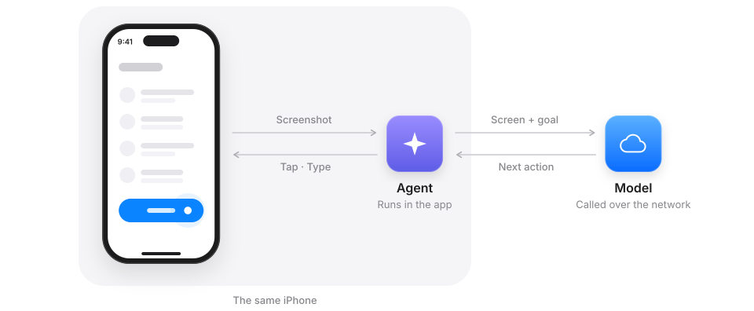
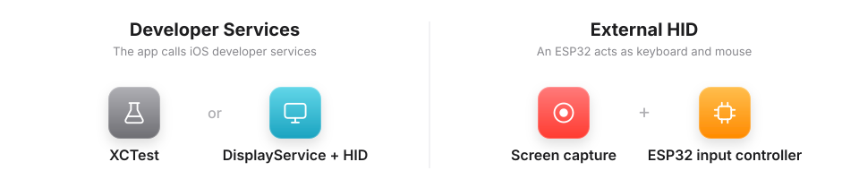
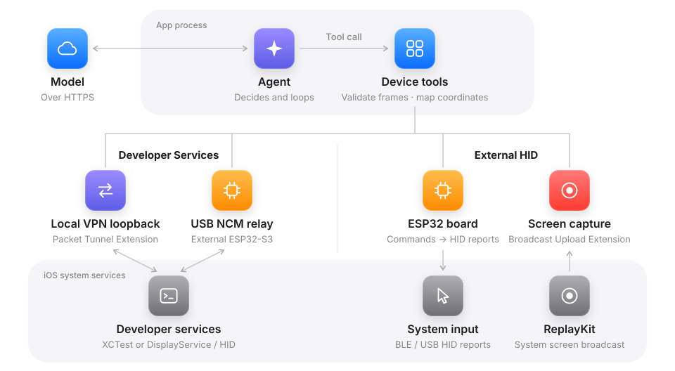
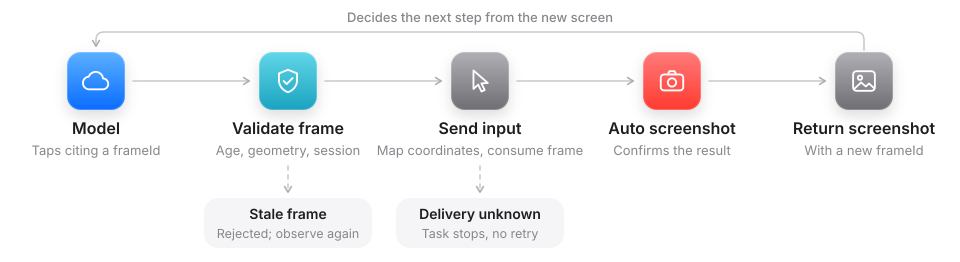
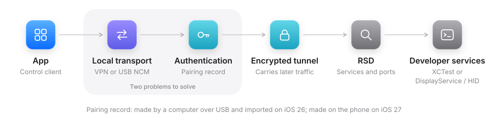
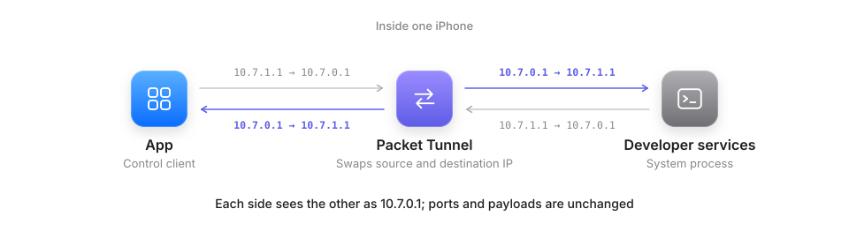
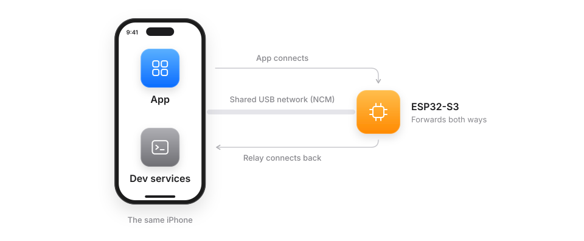
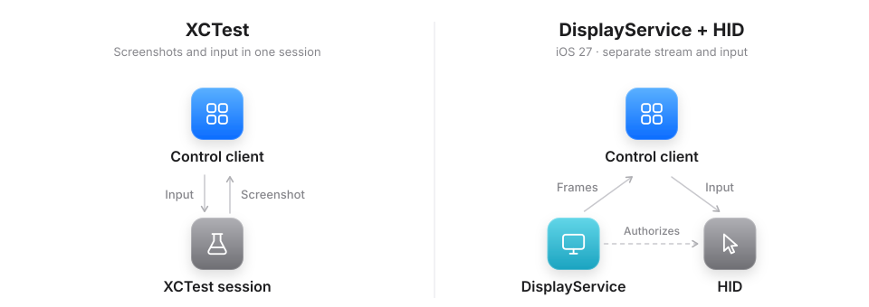
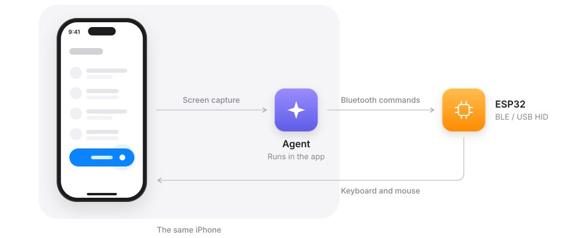
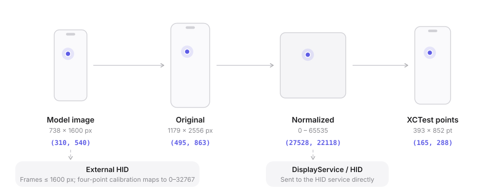

# Eiscue

**English** | [简体中文](README.zh-CN.md)

Eiscue is an agent assistant that runs on **iPhone and iPad** (iOS / iPadOS 26 or later). Conversations, task orchestration and tool execution happen on the device, and the model is called through an HTTPS service you configure. With your permission, the agent can also look at the screen and operate the device, including other apps.

> Development preview (`0.1.0`), installed with Xcode and development signing. It is not available on the App Store or TestFlight.

<p align="center"></p>

## How it works

The agent captures the screen, sends the screenshot and the goal to the model, and performs the next action on the same phone. iOS has no public API for one app to operate another, so Eiscue controls the device through one of two routes:

<p align="center"></p>

- **Developer Services** use the services iOS provides to Xcode: XCTest, or DisplayService for the screen together with the HID service for input. They need Developer Mode, a pairing record and the developer disk image, but no extra hardware.
- **External HID** sees the screen through system screen sharing (ReplayKit) and sends input through an ESP32 board that acts as a Bluetooth or USB keyboard and mouse. It needs no pairing record or developer disk image.

Both routes share one agent and one set of device tools in the app. A route never falls back to another one.

<p align="center"></p>

| Library | Responsibilities | Replacement interface |
| --- | --- | --- |
| [EiscueAgentKit](Sources/EiscueAgentKit/AgentClient.swift) | Agents, tools, events and conversation storage; runs PiDurableKit on JavaScriptCore, with one SQLite database per conversation | `AgentClient(engine:)` |
| [EiscueDeviceKit](Sources/EiscueDeviceCore/DeviceClient.swift) | Connection, observation, actions and capability status | `DeviceClient(actuator:networkSetup:hidSetup:)` |

The two libraries do not depend on each other; the app connects them. `EiscueHIDKit` is a variant of the device library without the developer-services backend.

### One tool call

<p align="center"></p>

Every action cites the newest screenshot's `frameId`, and each screenshot authorizes one action only. Eiscue checks the frame's age, orientation, size and session, maps the coordinates and sends the input, then returns a fresh screenshot in the same tool result. If delivery is uncertain, the task stops instead of retrying; a command acknowledgement never counts as success.

### Developer Services

<p align="center"></p>

Developer services normally serve a Mac connected by cable. To reach them from an app on the same phone, Eiscue first needs a local transport. It then authenticates with the pairing record, opens an encrypted tunnel, and asks RSD inside the tunnel for the services and their ports.

<p align="center"></p>

The default transport is a Packet Tunnel extension that reflects packets. It swaps the source and destination addresses, so the app and the system services each see the other as a virtual peer. Only that peer's host route enters the tunnel, with no default route or DNS, but the extension occupies the system VPN slot.

<p align="center"></p>

Alternatively, an ESP32-S3 acting as a USB network adapter (NCM) relays both connections and leaves the VPN slot free.

<p align="center"></p>

Two control backends are available. XCTest runs in a test session that the app opens for itself and provides both screenshots and input. On iOS 27 and later, DisplayService streams the screen and the HID service accepts input while the media session is active. The backend is chosen per connection and never falls back.

### External HID

<p align="center"></p>

A Broadcast Upload Extension keeps only the latest ReplayKit frame for the agent. The agent sends commands over Bluetooth to the ESP32, which taps and types as a BLE or USB HID keyboard and mouse, with AssistiveTouch enabled on the phone. An on-screen check calibrates touches and text before use; swipe is enabled only after relative-movement checks pass. HID cannot press Home or launch apps by bundle ID, so the agent navigates through visible controls.

### Coordinates

<p align="center"></p>

The model works in screenshot pixels. Eiscue maps a point from the image the model saw back to the original frame, then into the input space of the active backend: screen points for XCTest, normalized coordinates for DisplayService / HID, or the calibrated HID range for External HID.

## Features

- **Models**: OpenAI Chat Completions, OpenAI Responses and Anthropic Messages. Save several configurations; each API key stays in Keychain.
- **Tasks**: the permission scope is fixed when a task starts, and plain chat registers no tools. Tasks can be stopped and explicitly continued after a pause. Task details show steps, screenshots and provider-reported token usage; exported reports are redacted.
- **Background execution**: device tasks use iOS 26 `BGContinuedProcessingTask`, whose system Live Activity shows progress. iOS decides how long background work may run.
- **Attachments and dictation**: photos, camera, text and code files, PDFs, and on-device Apple Speech dictation. iOS mutes the microphone during a DisplayService session ([Apple](https://developer.apple.com/documentation/xcode/interacting-with-your-app-in-device-hub#Handle-camera-and-microphone-access-conflicts-on-physical-devices)), so recording temporarily releases control and restores it afterward.
- **Interface**: native Liquid Glass, light and dark appearance, English and Simplified Chinese, imported Markdown skills, and animated [vector heads](Artwork/EiscueHeads/README.md) that show connection status.

## Getting started

### Build and run

1. Use an Apple Silicon Mac with Xcode 26+ and [XcodeGen](https://github.com/yonaskolb/XcodeGen) 2.45+. Run `xcodegen generate`, open `Eiscue.xcodeproj` and select the `Eiscue` scheme.
2. Simulators work with the default local signing. For a device, set your development team and bundle IDs in `project.yml` and regenerate. The app needs an App Group shared with its broadcast extension and the Network Extension `packet-tunnel-provider` capability; see [AGENTS.md](AGENTS.md).
3. During onboarding or under **Settings → Model**, enter an HTTPS service URL, a model ID and an API key. Device tasks need a model with image and tool-call support.

For an app with ESP32 input only, without the developer-services backend or VPN extension, build the `EiscueHID` scheme or depend on the `EiscueHIDKit` product.

### Connect the device

Open the device page at the top right and choose a **Connection method**:

- **In app** (local VPN): enable Developer Mode and make sure the developer disk image is available. On iOS 27+, tap **Start pairing** and confirm in **Settings → Privacy & Security → Developer Mode**. On iOS 26, pair once from a Mac: tap **Copy command** and run it in Terminal from any folder.

  ```sh
  eiscue_setup_dir="$(mktemp -d -t eiscue-setup)" &&
  git clone --depth 1 https://github.com/LLLLLayer/Eiscue.git "$eiscue_setup_dir" &&
  python3 "$eiscue_setup_dir/Scripts/setup-device.py" --app-pairing-schema 1
  ```

  The Mac needs Xcode 26+, Python 3.9+, Rust 1.96.0 and internet access. Then choose **Import from computer** and **Connect** in the app. See the [USB pairing tool](Scripts/pair-device-usb.md) for details.
- **ESP32 input**: flash the [firmware](Firmware/Passport-BLE/README.md#build-and-flash-layout) and power the board, enable **AssistiveTouch**, then connect, start screen sharing and run the on-screen check. On an S3, choose **Bluetooth input** or **USB input**.
- **S3 USB network**: flash the [relay firmware](Firmware/NCM-Relay/README.md), connect the board's native USB port to the phone and give its Ethernet interface the manual address `192.168.7.2/24`. Pairing is still required.

**Control method** (DisplayService or XCTest) is chosen separately. Switching it releases the current connection and keeps the pairing.

## Build and test

```sh
xcodegen generate

# Kit tests, with an explicit Xcode and an isolated lockfile
DEVELOPER_DIR=/Applications/Xcode.app/Contents/Developer \
python3 Scripts/test-swift-package.py --scratch-path .build/kit-xcode26

# App unit tests
xcodebuild -project Eiscue.xcodeproj -scheme Eiscue \
  -destination 'platform=iOS Simulator,id=<SIMULATOR_ID>' \
  -only-testing:EiscueAppTests test
```

The full app and UI suite also needs the local model fixture, `python3 Scripts/test-model-server.py`, running in another terminal; no API key is required. The device backend (Rust 1.96.0) and the ESP32 firmware (ESP-IDF v5.5.3) have their own build scripts; see [AGENTS.md](AGENTS.md), the [backend README](Vendor/DeviceBackend/README.md) and the firmware READMEs. CI setup is described in [Scripts/ci.md](Scripts/ci.md).

## Privacy

- Screenshots are sent to the model you configure, both when the agent observes and after each action. Tool history, including screenshots, stays in the conversation's local database until the conversation is deleted.
- API keys and pairing identities are stored in device-only Keychain items, never in logs or exported reports.
- Screen sharing keeps only the latest frame, with no recording history or audio.
- Text input through DisplayService and HID pastes from the clipboard; XCTest types without it.
- Attachments are re-encoded to remove metadata and sent only with your message. Speech is recognized on the device.

## Status and limitations

Eiscue is a development preview. Coverage is limited: devices, iOS versions and long-running tasks may behave differently. Backend updates require renewed device checks; software tests alone do not establish input or background reliability. The developer-services routes rely on private interfaces and are not intended for App Store distribution. Background execution time is decided by iOS. The ESP32 firmware is a development prototype; pair boards only with phones you trust.

## Licenses and provenance

Eiscue as a whole does not yet have a unified distribution license. Components keep their own licenses:

| Component | Source / license |
| --- | --- |
| [DeviceBackend](Vendor/DeviceBackend/README.md) | Eiscue-maintained control runtime over pinned MIT idevice; GPL-3.0-only with retained compatibility notices. Linked by `Eiscue`, not `EiscueHID` |
| [LocalTunnel](Vendor/LocalTunnel/README.md) | Derived from LocalDevVPN / StosVPN under the custom StosVPN License |
| [Passport-BLE](Firmware/Passport-BLE/README.md#license-and-api-references) | Original firmware source is Apache-2.0; this does not extend to the [expression artwork](Firmware/Passport-BLE/Resources/README.md) |
| [NCM-Relay](Firmware/NCM-Relay/README.md) | The upstream combined project declares GPL-3.0-only; local files have GPL-3.0-or-later headers. See its `SOURCE_MANIFEST.json` |
| PiDurableKit | Pinned commit, CC0-1.0; embedded JS dependencies have separate notices |
| swift-markdown / swift-cmark | 0.9.0; license texts in the [app resources](Apps/Eiscue/Resources/OpenSourceLicenses) |

Dependency versions are in [Package.swift](Package.swift) and [project.yml](project.yml).
