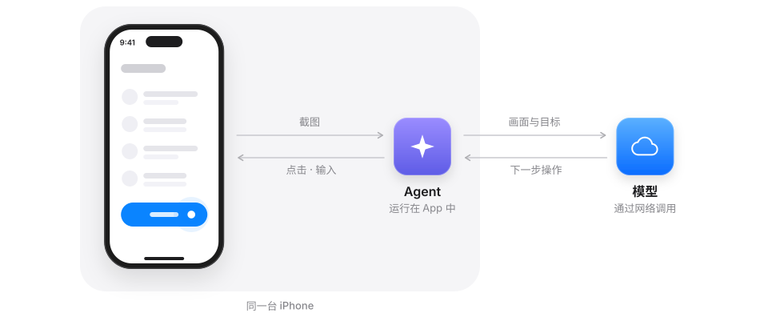
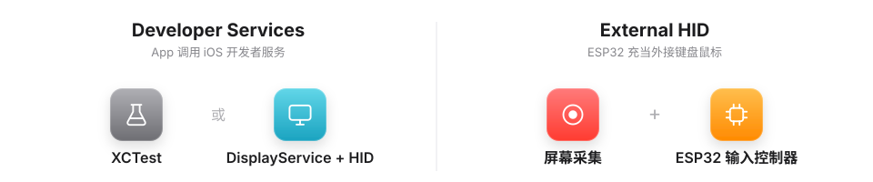
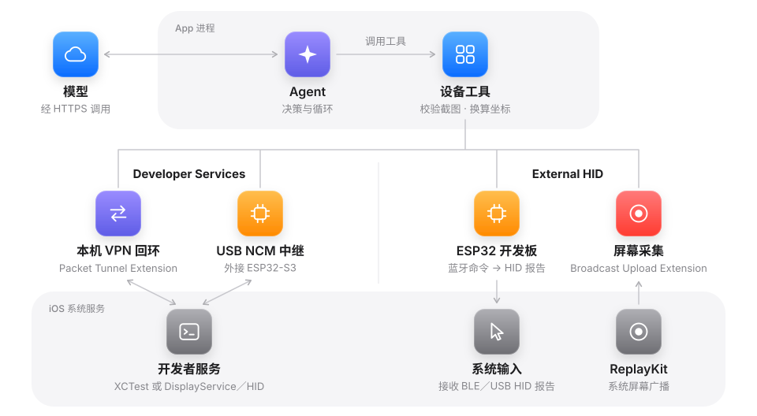
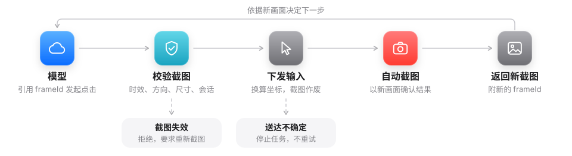
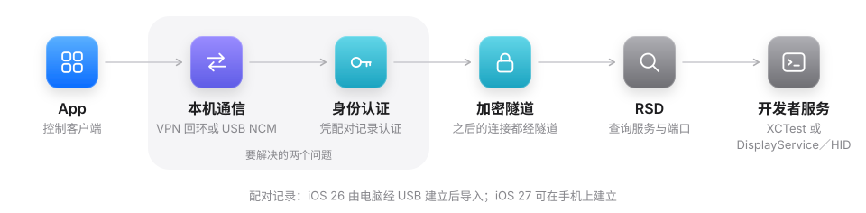
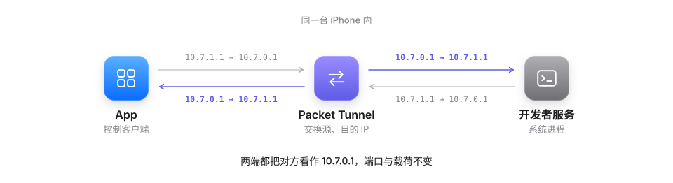
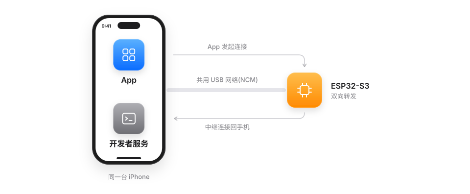
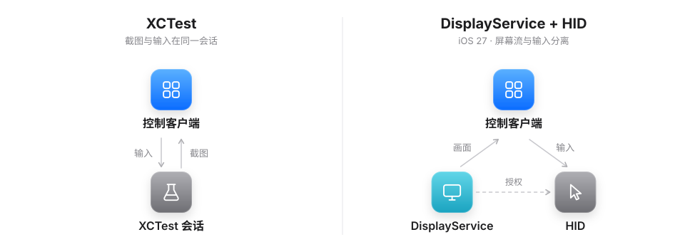
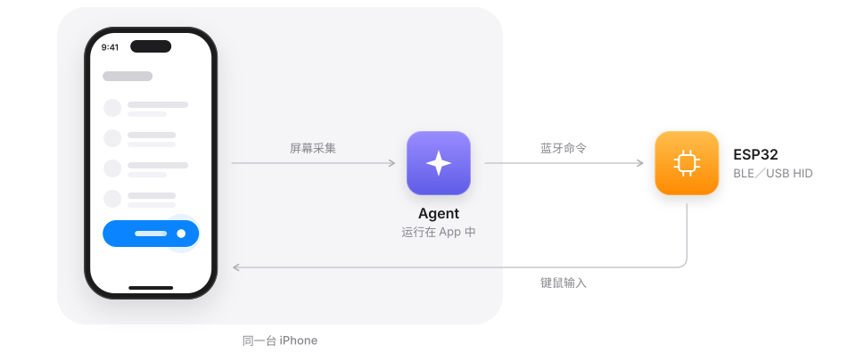
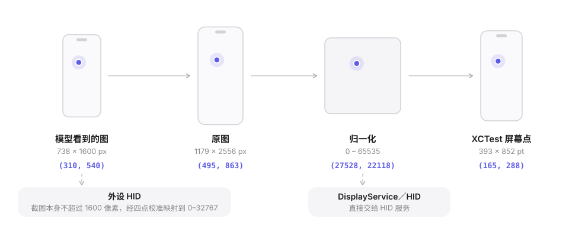

# Eiscue

[English](README.md) | **简体中文**

Eiscue 是运行在 **iPhone 和 iPad** 上的 Agent 助手，支持 iOS / iPadOS 26 及以上。对话、任务编排和工具执行都在设备上完成，模型通过你配置的 HTTPS 服务调用。经你允许后，Agent 还可以查看屏幕并操作这台设备，包括其他 App。

> 当前为开发预览（`0.1.0`），通过 Xcode 开发签名安装，尚未上架 App Store 或 TestFlight。

<p align="center"></p>

## 工作原理

Agent 截取当前屏幕，把截图和任务目标发给模型，再在同一台手机上执行下一步操作。iOS 没有让一个 App 操作其他 App 的公开接口，因此 Eiscue 通过两条路线之一控制设备：

<p align="center"></p>

- **Developer Services**：使用 iOS 提供给 Xcode 的开发者服务，即 XCTest，或由 DisplayService 提供画面、HID 服务接收输入。需要开发者模式、配对记录和开发者磁盘映像，不需要额外硬件。
- **External HID**：通过系统屏幕共享（ReplayKit）获取画面，由 ESP32 开发板充当蓝牙或 USB 键鼠输入。不需要配对记录或开发者磁盘映像。

两条路线在 App 内共用同一个 Agent 和同一套设备工具，路线之间不会自动回退。

<p align="center"></p>

| 库 | 职责 | 替换入口 |
| --- | --- | --- |
| [EiscueAgentKit](Sources/EiscueAgentKit/AgentClient.swift) | Agent、工具、事件和会话存储；在 JavaScriptCore 上运行 PiDurableKit，每个会话一个 SQLite | `AgentClient(engine:)` |
| [EiscueDeviceKit](Sources/EiscueDeviceCore/DeviceClient.swift) | 连接、观察、动作和能力状态 | `DeviceClient(actuator:networkSetup:hidSetup:)` |

两个库互不依赖，由 App 连接。`EiscueHIDKit` 是不含开发者服务后端的设备库版本。

### 一次工具调用

<p align="center"></p>

每个动作都要引用最新截图的 `frameId`，一张截图只能授权一次动作。Eiscue 校验截图的时效、方向、尺寸和会话，换算坐标后发送输入，再在同一个工具结果里返回新截图。送达结果不确定时任务停止、不重试；命令回执不算操作成功。

### Developer Services

<p align="center"></p>

开发者服务原本服务于通过数据线连接的 Mac。要让同一台手机上的 App 访问它们，Eiscue 先要建立本机通信，再凭配对记录完成认证、建立加密隧道，并经隧道向 RSD 查询服务和端口。

<p align="center"></p>

默认的本机通信由 Packet Tunnel 扩展反射数据包：它交换源地址和目的地址，让 App 与系统服务都把对方看作一个虚拟对端。只有发往该对端的主机路由进入隧道，不接管默认路由或 DNS，但会占用系统的 VPN 通道。

<p align="center"></p>

也可以由充当 USB 网卡（NCM）的 ESP32-S3 中继两条连接，这样不占用 VPN 通道。

<p align="center"></p>

控制后端有两种。XCTest 在 App 自行建立的测试会话中同时提供截图和输入；iOS 27 起，DisplayService 提供屏幕流，HID 服务在媒体会话存续期间接收输入。后端在每次连接时选定，不会自动回退。

### External HID

<p align="center"></p>

Broadcast Upload Extension 只为 Agent 保留最新一帧 ReplayKit 画面。Agent 通过蓝牙向 ESP32 下发命令，开发板以 BLE 或 USB HID 键鼠完成点击和输入，手机需开启辅助触控。使用前由屏幕上的检查完成触摸与文字校准；相对移动检查通过后才开放滑动。HID 无法回到主屏幕或按 bundle ID 打开 App，Agent 通过屏幕上可见的控件导航。

### 坐标

<p align="center"></p>

模型使用截图像素坐标。Eiscue 把模型所见图片上的点还原到原图，再换算到当前后端的输入空间：XCTest 用屏幕点，DisplayService／HID 用归一化坐标，External HID 用校准后的 HID 坐标范围。

## 主要功能

- **模型**：支持 OpenAI Chat Completions、OpenAI Responses 和 Anthropic Messages。可保存多组配置，每组 API Key 保存在 Keychain。
- **任务**：任务开始时固定权限范围，普通聊天不注册工具。任务可以停止，暂停后可明确继续。任务详情展示步骤、截图和服务商返回的 token 用量；导出报告已脱敏。
- **后台执行**：设备任务使用 iOS 26 的 `BGContinuedProcessingTask`，由系统实时活动展示进度；后台能运行多久由 iOS 决定。
- **附件与语音**：支持照片、拍摄、文本与代码文件、PDF，以及 Apple Speech 本机听写。DisplayService 会话期间 iOS 会静音麦克风（[Apple 说明](https://developer.apple.com/documentation/xcode/interacting-with-your-app-in-device-hub#Handle-camera-and-microphone-access-conflicts-on-physical-devices)），因此录音时会暂时释放控制，结束后恢复。
- **界面**：原生 Liquid Glass、浅色与深色模式、中英文界面、可导入的 Markdown Skill，以及展示连接状态的动态[矢量头部形象](Artwork/EiscueHeads/README.md)。

## 快速开始

### 构建与运行

1. 准备 Apple Silicon Mac、Xcode 26+ 和 [XcodeGen](https://github.com/yonaskolb/XcodeGen) 2.45+。运行 `xcodegen generate`，打开 `Eiscue.xcodeproj`，选择 `Eiscue` scheme。
2. 模拟器使用默认本地签名即可。真机需在 `project.yml` 中设置自己的开发团队和 Bundle ID 后重新生成。App 需要与屏幕共享扩展共用的 App Group，以及 Network Extension 的 `packet-tunnel-provider` 能力，详见 [AGENTS.md](AGENTS.md)。
3. 在首次引导或「设置 → 模型」中填写 HTTPS 服务地址、模型 ID 和 API Key。设备任务要求模型支持图片和工具调用。

如果只需要 ESP32 键鼠、不含开发者服务后端和 VPN 扩展，可构建 `EiscueHID` scheme，或依赖 `EiscueHIDKit` product。

### 连接设备

打开右上角设备页，在「连接方式」中选择：

- **App 内连接**（本地 VPN）：开启开发者模式，并确保开发者磁盘映像可用。iOS 27+ 点「开始配对」，在「设置 → 隐私与安全性 → 开发者模式」中确认。iOS 26 需在 Mac 上配对一次：点「复制命令」，在终端任意目录运行：

  ```sh
  eiscue_setup_dir="$(mktemp -d -t eiscue-setup)" &&
  git clone --depth 1 https://github.com/LLLLLayer/Eiscue.git "$eiscue_setup_dir" &&
  python3 "$eiscue_setup_dir/Scripts/setup-device.py" --app-pairing-schema 1
  ```

  Mac 需安装 Xcode 26+、Python 3.9+、Rust 1.96.0 并保持联网。完成后在 App 中点「导入电脑发送的配对」，再点「连接」。详见 [USB 配对工具](Scripts/pair-device-usb.md)。
- **ESP32 键鼠**：刷入[固件](Firmware/Passport-BLE/README.md#build-and-flash-layout)并给开发板供电，开启「辅助触控」，然后连接、开启屏幕共享并完成屏幕上的检查。S3 还需选择「蓝牙输入」或「USB 输入」。
- **S3 USB 网卡**：刷入[中继固件](Firmware/NCM-Relay/README.md)，把开发板的原生 USB 口接到手机，并把对应以太网接口手动设为 `192.168.7.2/24`。仍需完成配对。

「控制方式」（DisplayService 或 XCTest）单独选择；切换时会释放当前连接，保留配对。

## 构建与测试

```sh
xcodegen generate

# Kit 测试：指定 Xcode，隔离锁文件
DEVELOPER_DIR=/Applications/Xcode.app/Contents/Developer \
python3 Scripts/test-swift-package.py --scratch-path .build/kit-xcode26

# App 单元测试
xcodebuild -project Eiscue.xcodeproj -scheme Eiscue \
  -destination 'platform=iOS Simulator,id=<SIMULATOR_ID>' \
  -only-testing:EiscueAppTests test
```

完整的 App 与 UI 测试还需要在另一个终端运行本地模型服务 `python3 Scripts/test-model-server.py`，无需 API Key。设备后端（Rust 1.96.0）和 ESP32 固件（ESP-IDF v5.5.3）有各自的构建脚本，见 [AGENTS.md](AGENTS.md)、[后端说明](Vendor/DeviceBackend/README.md)及各固件 README。CI 配置见 [Scripts/ci.md](Scripts/ci.md)。

## 隐私

- Agent 观察屏幕时以及每次动作之后，截图都会发给你配置的模型。包括截图在内的工具历史保存在会话的本地数据库中，删除会话时一并清理。
- API Key 和配对身份保存在仅本设备可用的 Keychain 中，不进入日志或导出报告。
- 屏幕共享只保留最新一帧，不保留录屏历史，也不采集音频。
- DisplayService 和 HID 的文字输入经剪贴板粘贴；XCTest 输入不经剪贴板。
- 附件会重新编码以去除元数据，只随你的消息发送。语音在设备上识别。

## 状态与限制

Eiscue 是开发预览。各条路线均已实现并在真机上实际运行过，但覆盖范围有限，其他设备、iOS 版本和长时间任务的表现可能不同。开发者服务路线依赖私有接口，不面向 App Store 分发。后台执行时长由 iOS 决定。ESP32 固件是开发原型，请只与可信的手机配对。

## 许可与来源

整个 Eiscue 尚未选定统一发行许可。各组件保留各自的许可：

| 组件 | 来源 / 许可 |
| --- | --- |
| [DeviceBackend](Vendor/DeviceBackend/README.md) | actell 固定提交，GPL-3.0-only；内含 MIT 的 idevice。完整 `Eiscue` App 链接此后端，`EiscueHID` 不链接 |
| [LocalTunnel](Vendor/LocalTunnel/README.md) | LocalDevVPN / StosVPN 衍生实现，自定义 StosVPN License |
| [Passport-BLE](Firmware/Passport-BLE/README.md#license-and-api-references) | 原创固件代码为 Apache-2.0，不延及[表情资源](Firmware/Passport-BLE/Resources/README.md) |
| [NCM-Relay](Firmware/NCM-Relay/README.md) | 上游组合项目声明 GPL-3.0-only，本地文件带 GPL-3.0-or-later 头；详见其 `SOURCE_MANIFEST.json` |
| PiDurableKit | 固定 commit，CC0-1.0；嵌入的 JS 依赖另有声明 |
| swift-markdown / swift-cmark | 0.9.0；许可全文见 [App 资源](Apps/Eiscue/Resources/OpenSourceLicenses) |

依赖版本见 [Package.swift](Package.swift) 与 [project.yml](project.yml)。
